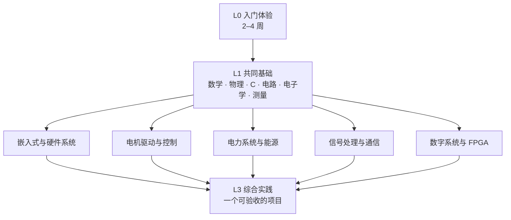

# EE 自学体系：四层结构与它的八个内容板块

> 八个板块是**内容分类**——你查某个知识点时去哪找。这一页给的是**学习结构**——你先学什么、共同的地基有多大、往哪个方向走、怎么算走完。
>
> 两者不是一回事。板块编号 01–08 不是学习顺序，方向分流也不要求你学完全部八个板块。

## 一句话结构

四个层次，自下而上：

| 层 | 内容 | 长度 | 出口 |
|---|---|---|---|
| **L0 入门体验** | 让身体先动起来：写第一段程序、接第一个电路、量第一个电压 | 2–4 周 | 一个能解释的小成果 |
| **L1 共同基础** | 数学、物理、C 语言、电路、电子学、测量 | 3–6 个月 | 能看懂后续课程的公式与电路图 |
| **L2 方向分流** | 选一条主线：嵌入式、电机驱动、电力系统、信号通信、数字 FPGA | 6–12 个月 | 该方向的核心课走完 + 一个小系统 |
| **L3 综合实践** | 一个能被别人验收的项目 | 1–3 个月 | 可复现的实物或仿真结果 + 一份记录 |

L2 只选一条。L3 是你选的那条方向的收口，不是五个方向都要做。

## 八大板块怎么用

板块是仓库，不是课表。每个板块内部按同一套结构组织：路线位置 → 核心课程 → 教材 → 习题实验 → 项目实战 → 我的笔记。

| 板块 | 在体系里的位置 |
|---|---|
| [01 数理与编程基础](/01-math-programming/README) | L1 的地基：微积分、线代、概率、大学物理、C/Python |
| [02 电路与电子学](/02-circuit-electronics/README) | L1 的主体：电路原理、模电、数电 |
| [03 嵌入式与单片机](/03-embedded-mcu/README) | L2「嵌入式」的主线 |
| [04 电机与运动控制](/04-motor-control/README) | L2「电机驱动」的主线；同时被「电力系统」依赖 |
| [05 电力系统](/05-power-system/README) | L2「电力系统」的主线 |
| [06 信号与通信](/06-signal-communication/README) | L2「信号通信」的主线；也是电机控制的前置 |
| [07 数字逻辑与 FPGA](/07-digital-fpga/README) | L2「数字 FPGA」的主线 |
| [08 硬件工具链](/08-hardware-toolchain/README) | 贯穿 L1–L3，不单独占阶段 |

## 共同基础：什么必须事先有，什么可以边做边补

完整清单见 [共同基础](/foundation)。这里的判断标准只有一条：**缺了它，下一步的实践做不下去，还是只是看不懂某段推导？**

| 内容 | 开始实践前必须有 | 可以边做边补 |
|---|---|---|
| 微积分 | 求导、积分、一阶微分方程的解（RC 瞬态要用） | 级数、多重积分、偏微分方程 |
| 线性代数 | 矩阵乘法、行列式、线性方程组（电路节点法要用） | 特征值、SVD（控制、信号再用时补） |
| 概率 | — | 随机变量、期望（信号与通信方向再补） |
| C 语言 | 变量、循环、函数、数组、指针、结构体 | 文件操作、位操作（做 MCU 时再补） |
| 电路 | 欧姆定律、KVL/KCL、戴维南等效、电容充放电 | 二阶电路、正弦稳态相量法 |
| 电子学 | — | 运放、BJT、MOSFET（做板子时再补） |
| 测量 | 万用表测电压/电阻、电源限流、面包板接线 | 示波器触发、逻辑分析仪协议解码 |

## 方向分流

五个方向不是平级的，也不是五个都要学。选一个主方向，其余按需取用。

| 方向 | 解决什么 | 核心课程链 | 当前内容 |
|---|---|---|---|
| [嵌入式与硬件系统](/directions/embedded) | 让数字硬件按你的意图跑起来 | C → 电路/数电 → MCU 外设 → RTOS → 小系统 | **充足**，有完整路线 |
| 电机驱动与控制 | 让电机按给定曲线转 | 电路 → 电机学 → 电力电子 → 自控 → FOC | 课程齐，缺一条串起来的验收链 |
| 电力系统与能源 | 分析、优化、调度大电网 | 电路 → 信号/概率 → 电力系统分析 → 优化 | 课程齐，项目偏仿真 |
| 信号处理与通信 | 从噪声里把信息取出来 | 高数/线代/概率 → 电路 → 信号与系统 → DSP/通信原理 | 课程齐，实验偏 Python 仿真 |
| 数字系统与 FPGA | 用并行硬件实现算法 | 数电 → Verilog → 时序与验证 | 课程齐，缺上板项目验收 |

完整的方向清单、依赖关系、每个方向的第一个项目与缺口优先级，见 [方向分流](/directions)。

## EE 核心知识块：覆盖检查

八个板块是按「学的时候是什么课」分的，所以有些知识块被拆散了、或者掉在缝里。逐个查一遍：

| 知识块 | 现在在哪里 | 被哪些方向依赖 | 状态 | 处理 |
|---|---|---|---|---|
| **电磁场** | 01 板块只有「大学物理-电磁学」（物理视角），02 板块没有工程电磁场 | 电机、电力系统、信号与通信 | **不足**：缺工程电磁场课（静电场、恒定磁场、麦克斯韦方程、准静态近似） | 本轮记录缺口，未新建课程页；在 01/02 板块交叉引用，待补 |
| **自动控制** | 04 板块「方向一：经典与现代控制理论」下有西工大《自动控制原理》、哈工程《现代控制理论》、MIT 6.241J | 电机驱动、电力系统、机器人电控 | **有课，归属错位**：放在电机板块里，电力系统方向的人不会去那里找 | 本轮不改文件位置，在 [方向分流](/directions) 与 04 板块页加交叉引用，标明它服务多个方向 |
| **电力电子** | 04 板块只有「中国大学 MOOC《电力电子学》（逆变器与 SPWM 章节）」——是章节级引用，不是完整课程条目 | 电机驱动、电力系统、开关电源 | **不足**：缺完整课程（拓扑、器件、驱动、闭环）与实验安排 | 记为 P0 缺口，待补课程页 |
| **电机** | 04 板块 华中科技大学《电机学》 | 电机驱动 | 有 | 保持 |
| **测量与实验** | 02 板块 MIT 6.071J（带实验）+ 08 板块仪器清单 | 所有要上硬件的方向 | **分散**：有仪器清单，没有「怎么设计一次测量、怎么解释误差」的方法页 | 本轮在 [共同基础](/foundation#测量与实验动手能力) 补一节方法；08 板块保留工具细节 |
| **复变函数 / 数学物理方程** | 无 | 信号与系统、电磁场 | **缺** | 记为 P2：写信号与系统课程页时一起补 |

结论：不新开「电磁场板块」「电力电子板块」。它们属于**课程**，塞进现有板块即可；真正需要新增的是**一条把课程串起来的路线**和**几张课程页**。

## 综合实践：每个方向的收口

L3 不设统一项目。每个方向有各自的验收形态：

| 方向 | 收口形态 | 验收看什么 |
|---|---|---|
| 嵌入式与硬件系统 | 一块持续运行的采集/控制节点 | 连续 48 小时不重启、数据可解析、拔掉传感器不卡死 |
| 电机驱动与控制 | 一个闭环转速/位置系统 | 阶跃响应曲线能解释，稳态误差在给定范围内 |
| 电力系统与能源 | 潮流或调度的小型求解器 | 与标准测试系统结果对得上，误差可解释 |
| 信号处理与通信 | 一条完整收发链路或频谱分析工具 | 能说清采样率、混叠、窗函数对结果的影响 |
| 数字系统与 FPGA | 上板可交互的数字逻辑 | 时序约束通过，逻辑分析仪抓到的波形与预期一致 |

每个方向的具体验收标准写在方向页里；目前只有嵌入式方向写到了可执行的程度，其余四个是待补的骨架。

## 这一页不承诺什么

- 不承诺完成这套体系等同于获得学位，也不等同于一所学校的培养方案。它是一份自学路线。
- 不承诺学时准确。学时是本仓库编辑的估算，标注了「编辑估计」的都不是课程官方数据。
- 不承诺所有资源长期有效。站内只对实际打开过的条目记录核验日期。

## 参考了什么

本页的层次划分借鉴了以下公开项目的组织方式，内容为针对 EE 独立编写，未复制其正文：

| 参考 | 借用的机制 | 本项目的适配 |
|---|---|---|
| [csdiy.wiki](https://csdiy.wiki/)（[仓库](https://github.com/PKUFlyingPig/cs-self-learning)，MIT） | 按读者类型分三档；明说「不需要学完所有课程」；课程地图之外允许读者自选 | 三档读者 → [如何使用本站](/guide)；「不学完」→ 方向只选一条 |
| [ossu/computer-science](https://github.com/ossu/computer-science)（MIT） | Intro / Core / Advanced / Final Project 四段结构；每课标 Duration、Effort、Prerequisites；选课有明确标准 | 四层结构 L0–L3；课程页统一字段；选课标准写进 [课程模板](/templates/course-template) |
| [ForrestKnight/open-source-cs](https://github.com/ForrestKnight/open-source-cs)（MIT） | 课程表列出 School / Duration / Effort / **Frequency** / Prerequisites | 「开课频率」并入课程页的「访问条件」一栏，作为维护性的判断依据 |
| [EVAAAs/HUST_SEEE_Intro](https://github.com/EVAAAs/HUST_SEEE_Intro)（仓库声明 CC BY-NC-SA 4.0） | 学校维度的课程覆盖面清单：电磁场、自控、电力电子、电机、检测技术、高电压等 | 只借「用一张表盘清核心课覆盖」的方法，**不套用其课程、学分与开课学期**；华科与哈工大（深圳）不是同一套培养方案 |

引用的组织方法不构成对上述项目内容的转载；若后续需要引用其正文，按各自许可处理。
