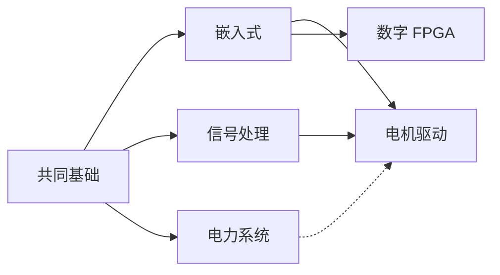

# 方向分流：课程与实践要求

电气电子的几个方向共享一部分基础，但关注的问题不同：嵌入式偏重设备中的程序与接口，电机控制关注机电系统的动态行为，电力系统研究网络运行，信号处理研究信息的表示与提取，FPGA 则侧重数字硬件结构。

选择时可以先看自己希望解决的问题，再比较所需的基础与实验条件。只有计算机也能开始控制、电力系统或 FPGA 的仿真学习；具备开发板也不意味着必须选择嵌入式。实物验证需要的设备可以在任务明确后逐步准备。

建议先试做一个范围较小的练习，记录遇到的概念和工具问题。它比仅凭方向名称作决定更有参考价值。下面列出各方向的课程链与本站目前的内容覆盖情况。

## 五条线总览

| 方向 | 主线问题 | 课程链 | 内容状态 |
|---|---|---|---|
| [嵌入式与硬件系统](#嵌入式与硬件系统) | 让数字硬件按你的意图跑起来 | C → 电路/数电 → MCU 外设 → RTOS → 小系统 | 已有独立路线页 |
| [电机驱动与控制](#电机驱动与控制) | 让电机按给定曲线转 | 电路 → 电机学 → 电力电子 → 自动控制 → FOC | 已有课程资源，缺验收链 |
| [电力系统与能源](#电力系统与能源) | 分析、优化、调度电网 | 电路 → 信号/概率 → 电力系统分析 → 优化 | 已有课程资源，项目偏仿真 |
| [信号处理与通信](#信号处理与通信) | 从噪声里把信息取出来 | 数学 → 电路 → 信号与系统 → DSP / 通信原理 | 已有课程资源，实验偏仿真 |
| [数字系统与 FPGA](#数字系统与-fpga) | 用并行硬件实现算法 | 数电 → Verilog → 时序约束 → 上板 | 已有课程资源，缺上板验收 |

依赖关系（箭头是「先修」）：

虚线表示「电力系统的建模与分析能力会帮助电机控制里的系统级设计」，但不是硬前置。

## 嵌入式与硬件系统

**完整路线见 [嵌入式与硬件系统方向路线](/directions/embedded)。** 这是本轮唯一写到可执行程度的方向。

**为什么选它做示范**：现有内容最充足——03 板块有 5 门课程卡片（Arduino 官方、浙大 STM32、电科大 HAL、FreeRTOS 官方、ARM Cortex-M 文档），08 板块有 18 条工具条目，01 板块有 C 语言笔记与 CS50x。基础、课程、工具三块都在，缺的只是把它们串起来并给出验收。

**课程链**：C 语言 → 电路与测量 → 数字逻辑 → MCU 外设（GPIO/中断/定时器/串口）→ 总线（I2C/SPI）→ RTOS → 综合项目。

**第一个可验收项目**：环境监测节点。验收标准写在路线页里，四条，都能当众演示。

## 电机驱动与控制

**适合谁**：已经能让 MCU 跑起来，想让机械部分动；或做电赛、机器人、无人机。

**课程链**：

1. 电路与电子学（[02 板块](/02-circuit-electronics/README)）—— 逆变桥、驱动电路、电流采样都建立在这
2. 电机学（[04 板块 · 华中科技大学《电机学》](/04-motor-control/README)）—— 为什么通电会转、气隙磁通怎么算
3. 电力电子（**缺口**，见下方优先级）—— 拓扑、开关器件、PWM、死区
4. 自动控制原理（[04 板块 · 西北工业大学](/04-motor-control/README)）—— 传递函数、根轨迹、频域校正
5. 现代控制理论（哈工程，同上）—— 状态空间、观测器
6. FOC 实践（[04 板块 · ST X-CUBE-MCSDK](/04-motor-control/README)）

**第一个可验收项目**：开环六步方波驱动 BLDC（已有卡片），然后是 PMSM 速度环闭环。

**验收看什么**：给定阶跃转速指令，能画出转速响应曲线，稳态误差与超调在你自己设定的范围内，并能解释 PI 参数与曲线形状的关系。

**当前缺口**：电力电子没有完整课程条目；自控理论被放在 04 板块下，做电力系统的读者不会来这找——见 [课程体系 · 覆盖检查](/curriculum#ee-核心知识块覆盖检查)。

## 电力系统与能源

**适合谁**：电气专业往电网、设计院、新能源走；或做潮流、调度、储能优化。

**课程链**：

1. 电路（[02 板块](/02-circuit-electronics/README)）
2. 电气工程基础 / 电力系统分析（[05 板块](/05-power-system/README)：华中科大《电气工程基础》、中国大学 MOOC《电力系统分析》）
3. 概率与优化（[01 板块](/01-math-programming/README) 概率部分 + 线性规划基础）
4. 电力电子（同样受限于缺口）—— 新能源并网、直流输电要用
5. 方向选修：NPTEL 电力系统动态 / 运行与控制、广工《电力系统分析（下）》

**第一个可验收项目**：九节点潮流可视化（已有卡片）。验收：与标准测试系统（IEEE 9 节点）的公开结果对比，各节点电压幅值误差可解释。

**当前缺口**：项目全部偏仿真，没有硬件形态；购电量测、继保这类实验在自学场景里确实难做，如实标为「需要实验室或仿真替代」。

## 信号处理与通信

**适合谁**：想做 DSP、通信、音频、传感器信号处理；或希望进一步理解频域分析。

**课程链**：

1. 微积分 + 线代 + 概率（[01 板块](/01-math-programming/README)）
2. 电路（[02 板块](/02-circuit-electronics/README)）
3. 信号与系统（[06 板块](/06-signal-communication/README)：MIT RES.6.007、Berkeley EE120）
4. 数字信号处理（北交大、MIT 6.341）
5. 通信原理（西电）

**第一个可验收项目**：用 Python 做一次完整的采样与频谱分析——生成正弦波，故意低于奈奎斯特采样，观察混叠，再用窗函数改善泄漏。

**验收看什么**：能解释混叠频率的公式来源，能说清为什么加窗会改变频谱形状，能把时域波形与频谱对应起来。

**当前缺口**：全部依赖 Python 仿真，没有 DSP 板卡类实验；复变函数作为前置没有独立条目。

## 数字系统与 FPGA

**适合谁**：想做硬件加速、数字电路设计、时序密集型系统。

**课程链**：

1. 数字电子技术（[02 板块](/02-circuit-electronics/README) 数电部分、[07 板块](/07-digital-fpga/README) 清华数电）
2. Nand2Tetris（07 板块）—— 从门到 CPU 的体系结构直觉
3. Verilog（07 板块 · Nandland）
4. 数字系统实验（MIT 6.111）
5. 工具链与约束（AMD/Xilinx Vivado、Intel Quartus 官方文档）

**第一个可验收项目**：写一个 UART 收发器（Verilog），在 FPGA 上回环，用逻辑分析仪抓波形。

**验收看什么**：时序约束通过、比特率误差 < 2%、逻辑分析仪抓到的波形与设计预期一致。

**当前缺口**：没有上板项目的验收记录；开发板型号与工具版本需要作者补充实测。

## 缺口与优先级

本轮只记录，不生成空页面。按「影响多少人 + 卡住多少条线」排序：

| 优先级 | 缺口 | 影响 | 建议处理 |
|---|---|---|---|
| **P0** | 电力电子完整课程条目（拓扑、器件、驱动、闭环，含实验安排） | 卡住电机驱动与电力系统两条线 | 在 04 板块内补一条完整课程卡片，被 05 引用。**当前卡在选课**：现有 MOOC 链接的页面标题不含院校，无法确认是哪门课，需先确认来源再写课程页 |
| **P0** | 自动控制原理的交叉引用（它现在只在 04 板块） | 电力系统、机器人方向找不到它 | 不改文件位置，在 05 板块与方向页加链接与「服务多方向」说明 |
| **P1** | 工程电磁场课程（静电场、恒定磁场、麦克斯韦、准静态） | 电机、电力系统、信号都依赖 | 补课程页并挂在 01/02 交叉位置 |
| **P1** | 测量与实验的独立方法页（现在只有一节） | 所有硬件方向的实验质量 | 可扩成板块页，或维持 `foundation` 一节并补案例 |
| **P1** | 电机驱动的闭环验收链（从开环到 FOC 的检查点） | 该方向无「算走完」标准 | 参照嵌入式路线写一份 |
| **P2** | 复变函数 / 数学物理方程条目 | 信号与系统、电磁场的前置 | 写信号课程页时一并补 |
| **P2** | FPGA 上板验收记录（板型、工具版本、实测波形） | 该方向缺真实证据 | 需作者本人实测后补，不代写 |

## 与八大板块的关系

方向页和板块页是一张网的两面：

- **板块页**回答「这门课讲了什么、去哪找资源」——按学科存。
- **方向页**回答「我先学哪门、学到哪算过、下一步做什么」——按路径排。

同一门课会同时出现在两处：板块页是它的卡片，方向页是它在路径里的位置。两者互相链接，不重复维护资源信息。
